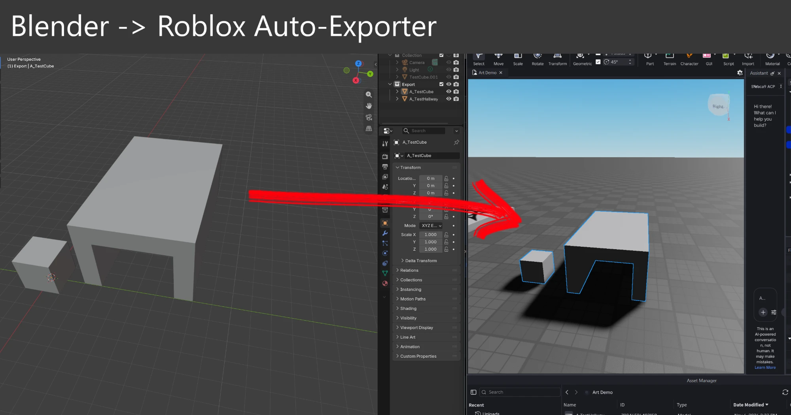

# Blender → Roblox asset loop

Edit in Blender, save, and the objects you changed are re-exported as FBX, uploaded to the
**same** Roblox asset ID, and swapped into your open Studio place.

What this is: three small scripts plus a convention. It is not a plugin. Uploading and swapping
are done by an MCP client (e.g. Claude) talking to Studio's built-in MCP server, which holds the
Open Cloud permission, so **no API key is stored in any file**.

Tested on: Blender 5.2.1 LTS, Windows 11, Roblox Studio with the Studio MCP server enabled.
Not tested elsewhere.

## Pieces

| File | Runs in | Does |
|---|---|---|
| `rbx_export.py` | Blender (startup script) | On every save, exports each mesh object in the `Export` collection to `<export_dir>/<ObjectName>.fbx`, only if its geometry, UVs, materials or transform changed. Apply Scaling = FBX Unit Scale. |
| `rbx_watch.ps1` | PowerShell | Prints `CHANGED <name>.fbx` when an FBX changes, so an MCP client can push it. |
| `rbx_swap.luau` | Studio (via `execute_luau`) | Reloads tagged models from their asset, keeping position, rotation, anchoring and attributes. Placed copies do **not** update by themselves when an asset gets a new version. |
| `rbx_assets.template.json` | — | Name → asset ID map. Copy to `rbx_assets.json`. |

## Setup

1. Studio → Assistant → **…** → Manage MCP Servers → enable *Studio as MCP server*, and connect your client
   ([docs](https://create.roblox.com/docs/en-us/studio/mcp.md)).
2. Studio → Assistant Settings → **MCP Permissions**: allow *Publish & manage assets* (`asset:read`, `asset:write`)
   and add your export folder under *Open Cloud upload directories*.
3. Copy `config.example.json` to `~/.rbx_pipeline/config.json` and edit the paths (or set `RBX_PIPELINE_CONFIG`).
4. Copy `rbx_export.py` into Blender's `scripts/startup` folder, e.g.
   `%APPDATA%\Blender Foundation\Blender\<version>\scripts\startup\`, and **restart Blender**.
5. In your .blend, make a collection named `Export`. Every mesh object in it (child collections are fine) becomes its own asset.

## Loop

1. First time per object: upload its FBX with `POST /assets/v1/assets` and record the returned asset ID in `rbx_assets.json`
   and in `ASSETS` inside `rbx_swap.luau`.
2. After that: edit in Blender, Ctrl+S. Then PATCH `/assets/v1/assets/{assetId}` with the new FBX
   ([Assets API guide](https://create.roblox.com/docs/en-us/cloud/guides/usage-assets.md)) and run `rbx_swap.luau`.
   An MCP client can do both automatically when `rbx_watch.ps1` reports a change.
3. To make a model swappable: `CollectionService:AddTag(model, "RBXAsset")` and `model:SetAttribute("rbxAssetId", id)`.
   `rbx_swap.luau` also auto-tags untagged models named `<Asset>` or `<Asset> <n>`.

## Caveats

- Object name = FBX name = asset identity. **Renaming an object makes a new asset.**
- Uploads are permanent and Open Cloud cannot delete them; every PATCH adds a revision.
- Content updates via PATCH work for `.fbx` only, 20 MB per call; the endpoints are beta.
- A placed MeshPart keeps pointing at the mesh version it was inserted with; that is why the swap step exists.
- Check Roblox's per-mesh triangle limits before uploading
  ([specs](https://create.roblox.com/docs/art/modeling/specifications.md)).
- Stale FBX files are never deleted when you delete an object.
- The unofficial Blender MCP, if you add one, runs LLM-generated code in Blender with no guards: back up your .blend files.

## Manual export

```
blender -b file.blend --python rbx_export.py -- --run [--force]
```
